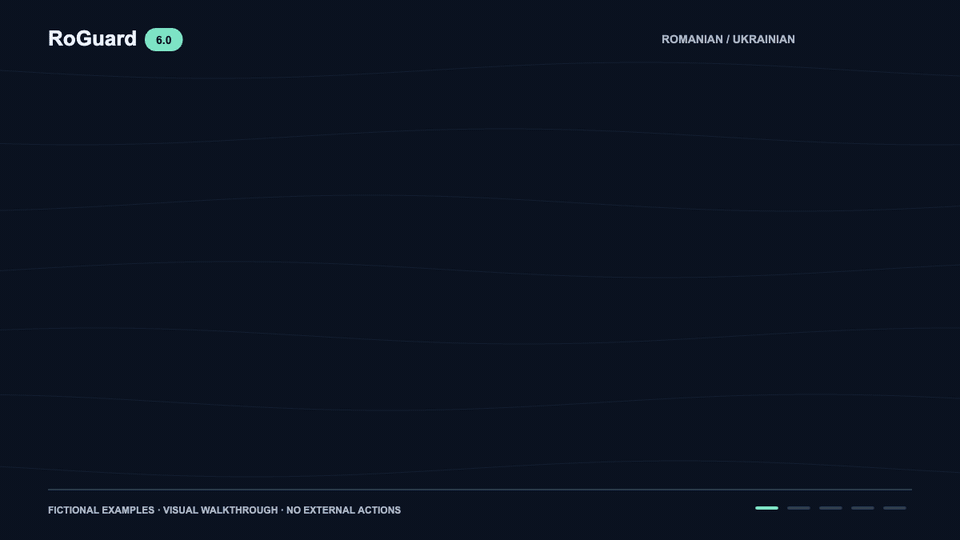

# RoGuard — Romanian and Ukrainian child-safety research toolkit

[](https://pepy.tech/project/roguard-child-safety)
[](https://github.com/xyz-rafael-xyz/roguard-child-safety/stargazers)

[](https://github.com/xyz-rafael-xyz/roguard-child-safety/actions/workflows/ci.yml)
[](https://pypi.org/project/roguard-child-safety/)
[](https://pypi.org/project/roguard-child-safety/)
[](LICENSE)

[](docs/V6_RELEASE.md)
[](docs/RELIABILITY.md)
[](docs/RELIABILITY.md)

[](media/roguard-demo.mp4)

**[Watch the RoGuard v6 walkthrough](media/roguard-demo.mp4)** · [Transcript and demo evidence](docs/DEMO_VIDEO.md) · Fictional examples; actual v6 outputs.

**RoGuard 8 experimental preview: structured evidence and response proposals.** The new opt-in workspace separates subject, time, assertion, source, relation and concern; tracks candidate contradictions and host-reviewed revisions; and checks response alternatives against task coverage and source permissions. Training studies include **75,984 distinct fictional conversation inputs**, separate development/calibration/test partitions, and a follow-up conversational adaptation. Large synthetic counts do not establish real-world accuracy. The stable v7 workflow remains available. [Preview setup](docs/EVIDENCE.md) · [Experiments, comparisons and limits](docs/V8_PREVIEW.md).

**RoGuard 7.1 reduces Romanian and Ukrainian false alerts.** The latest patch, **7.1.1**, also fixes negated phrase matches in the bounded language rules. The joint context model was retrained and recalibrated, with explicit topic-shift checks, separate rule evidence and clearer uncertainty labels. On the original synthetic regression set, benign review requests fell from 20/126 to 1/126 in Romanian and 29/126 to 2/126 in Ukrainian, while retaining all 90 checked non-quoted concerns per language. Remaining errors and all rejected candidates are documented; these are not real-world accuracy claims. [Full results and limits](docs/V7_1_RELEASE.md).

**RoGuard 7: conversation evidence review.** An optional jointly trained Romanian/Ukrainian model proposes current/past, other-person, quotation, correction and uncertainty interpretations, with turn references and a separate concern-mention prediction. A local review screen, authenticated analysis endpoint and tutoring integration connect those proposals to source-linked permissions. **Experimental: synthetic evidence only, with remaining Ukrainian and calibration errors.** [Try the workflow](docs/CONTEXT.md) · [Training iterations and results](docs/V7_RELEASE.md).

**RoGuard 6.0 adds an adapted language model and durable application controls:** authenticated tenant APIs, encrypted permission state, queued execution, metadata-only monitoring, long-conversation analysis and permission-aware repair. [Setup and integration](docs/RELIABILITY.md) · [v6 experiments and limits](docs/V6_RELEASE.md).

The new optional `adapted` backend passed its registered improvement gate after three training iterations. Its final fresh test contains only six synthetic phrase families per language: 18/18 signals recovered and 0/12 false alerts at fixed cutoffs in each language. The calibrated API abstained on 1/30 Romanian and 4/30 Ukrainian cases, with no wrong decided cases on that small test. **This does not establish real-world child-language accuracy.** Earlier failed candidates and actual-model comparison failures remain visible in the release record. The lightweight default is unchanged.

Open the new local workflows with `roguard-studio --reliability --open`. The v5 interaction laboratory remains available, including:

| New workflow | Use |
|---|---|
| Simulate and reduce | Connect a callable or recorded chatbot response sequence, replay fictional branches, and obtain a reproducible failing scenario. |
| Preserve restrictions | Derived artifacts inherit all source restrictions; dispatch rechecks revocation, expiry, purpose and recipient. |
| Minimize disclosure | Find the lowest-cost permitted field set covering explicit task requirements. |
| Test consistency | Distinguish changes that should preserve a decision from policy changes that should reverse it. |
| Measure useful assistance | Report unnecessary refusal and permitted-task completion alongside unauthorized proposals and deliveries. |

The browser and CLI simulate actions. The Python gateway can invoke only explicitly configured host callbacks, with external-operation approval and current-policy checks. It is an integration boundary, not a sandbox for arbitrary Python or a verifier of legal authority.

This project is independent of Roblox. [Roblox Guard 1.0](https://about.roblox.com/newsroom/2025/07/roblox-guard-advancing-safety-for-llms-with-robust-guardrails) is a separate LLM moderation toolkit; there is no affiliation, shared model, or compatibility claim. The PyPI distribution is named `roguard-child-safety`; Python imports remain `roguard`.

Contributors: read [CONTRIBUTING.md](CONTRIBUTING.md) and the [Code of Conduct](CODE_OF_CONDUCT.md) before opening an issue or pull request.

## What the checker does

Each check compares **facts supplied by the caller** with a declared rule. The tool marks those facts as unverified; it does not establish whether a person's account is true, who holds legal authority, or whether a proposed response is helpful in a real case.

| Code | Check | Python function | What the result means |
|---|---|---|---|
| D1 | Declared disclosure and support-signal fields | `check_disclosure_evidence` | Checks the caller's field declarations; does not interpret a child's words. |
| R1 | Recipient and purpose scope | `check_routing` | Checks whether the proposed recipient fits an explicit rule. A relationship alone grants no access. |
| A1 | Declared or locally counted words against a caller-supplied cap | `check_readability_contract` | Checks length only. It does not measure readability or comprehension. |
| P1 | Permission state and repeated boundary pressure | `check_permission`, `check_boundary` | Checks declared permission events and boundary facts. `check_boundary` is part of P1. |
| G1 | Human-review gate before an external action | `check_gate` | Flags an automatic external branch or a missing review owner in the declared flow. |
| S1 | Declared support-response fields | `check_support_contract` | Checks fields marked applicable by the caller; does not judge a real reply. |

The design couples explicit person–item–purpose–recipient rules and permission history with one-fact counterfactual tests. It keeps model signals separate from authority and external-action decisions; the [novelty note](docs/NOVELTY.md) states the narrower research contribution and prior-work limits.

The retained v3 `roguard-message-screen` command adds an **advisory D1 signal** from text when the caller declares `minor` as the source role. Its synthetic score is not a safety probability; a negative signal cannot close a concern, and a positive signal cannot grant guardian access. Both languages use separately trained, offline models. See [the registered study](docs/V3_MESSAGE_STUDY_PROTOCOL.md).

The CLI can count A1 words locally when text is supplied; the cap still comes from the caller. The historical [Romanian v0.2 taxonomy](taxonomy/taxonomy_ro.md) and [Ukrainian draft v0.1 taxonomy](taxonomy/taxonomy_uk.md) remain bound to their original batches. The corrected [Romanian v1 candidate](taxonomy/taxonomy_ro_v1_candidate.md) and [Ukrainian v1 candidate](taxonomy/taxonomy_uk_v1_candidate.md) incorporate the later specialist review. The owner-attested, exact-version taxonomy review records now pass structural checks; the model study gate remains open. The [taxonomy review disposition](docs/TAXONOMY_REVIEW_V1.md) and [v1 evidence ledger](docs/V1_EVIDENCE.md) explain the open gates.

A **synthetic abstract card** is an invented description of annotation fields or policy facts, with no real or realistic child statement. A **complete one-fact pair** is a positive card and its minimally changed negative, both classified correctly. Those pairs measure an invented-card task, not accuracy on children's messages. When a professional has reporting duties, this software does not determine or replace them; follow applicable law, organizational policy, and qualified human judgment.

## Install and try it

Install or upgrade to the **latest PyPI release** in one command (Python 3.9–3.14):

```sh
pip install --upgrade roguard-child-safety
```

Open the new local interaction laboratory:

```sh
roguard-studio --lab --open
```

For text and draft-response review, use `roguard-studio --conversation --open`. The two workspaces link to each other.

The default fast model needs no additional download. For the **stronger semantic backend** (Python 3.10+, tested on 3.12), install the optional dependencies and fetch the pinned model once:

```sh
pip install --upgrade 'roguard-child-safety[semantic]'
roguard-model fetch
roguard-studio --conversation --open --backend semantic
```

For the new adapted encoder and calibrated decisions (Python 3.10+, verified on 3.12):

```sh
pip install --upgrade 'roguard-child-safety[adapted]'
roguard-model fetch
roguard-studio --conversation --open --backend adapted
```

For the **new contextual evidence workspace**, using the same `adapted` installation and pinned model:

```sh
roguard-studio --context --context-backend joint --open
```

It proposes interpretations and reviewer questions; it does not verify disclosures or authorize sharing. [Python tutoring integration and API](docs/CONTEXT.md).

For an authenticated application service, see [the three-command setup](docs/RELIABILITY.md#authenticated-service). The optional `gateway` and `observability` extras keep the core install small.

The model download is about 1.2 GB. Subsequent inference is offline; no conversation is sent to the model host. The fast and semantic backends have different measured accuracy. The [guide](docs/CONVERSATION_WORKSPACE.md) covers batch input, report comparison and Python integration.

If `pip` points to another Python installation, use `python3 -m pip install --upgrade roguard-child-safety` (or `py -m pip install --upgrade roguard-child-safety` on Windows). Installation needs internet access; the installed checker and message scorer run offline. GitHub also retains a [direct-release source archive](https://github.com/xyz-rafael-xyz/roguard-child-safety/releases/latest/download/roguard-child-safety-latest.tar.gz). To run the included fictional examples or work on the source, clone the repository:

```sh
git clone https://github.com/xyz-rafael-xyz/roguard-child-safety.git
cd roguard-child-safety
python3 -m venv .venv
.venv/bin/python -m pip install .
.venv/bin/python -m roguard examples/contracts_ro.json
.venv/bin/python -m roguard examples/contracts_uk.json
```

On Windows, create the environment with `py -3.12 -m venv .venv` and use `.venv\Scripts\python.exe` in the last three commands. The examples are fictional, caller-declared contracts; no model download is needed. For your own declared contract, copy an [example](examples/contracts_ro.json), edit its fields, and run the same command. The [JSON Schema](schema/contract-input.schema.json) and [CLI guide](docs/CLI.md) describe every field and status.

To try the **experimental message scorer**, use `.venv/bin/roguard-message-screen examples/message_screen_ro.json` or `examples/message_screen_uk.json`. It reads a three-field JSON object and returns an advisory code without echoing the message or sending it anywhere. The two small model files are included in the wheel; no training package or download is needed for inference. The [v3 guide](docs/V3_MESSAGE_RELEASE.md) explains the synthetic results and limits. For reproduction of the fit, install `.[message-train]` separately.

`roguard-studio --open` opens a loopback-only [Decision Studio](docs/DECISION_STUDIO.md). Its default guided Romanian/Ukrainian form checks corrected D1/R1/S1 symbolic facts. The new **Audit uncertainty** action lets each S1 criterion stay unknown independently, lists every reachable decision, shows symbolic witnesses, and suggests which fact to clarify next. Other actions check a complete card or explore one-fact changes. The command-line `roguard-v2-audit examples/v2_uncertainty_ro.json` runs the new audit; the [Ukrainian example](examples/v2_uncertainty_uk.json) uses the same rule with a separate language tag. `roguard-v1-envelope` remains for earlier input cards, and `roguard-explore examples/proposed_use_ro.json` tests historical one-fact changes. These are local consistency tools, not model accuracy tests. `python -m roguard --jsonl examples/contracts_mixed.jsonl` checks multiple contracts after validating every line.

For a small routing check in Python:

```python
from roguard import RoutingCard, check_routing

card = RoutingCard(
    principal="minor",
    item="element-simbolic",
    purpose="A",
    proposed_recipient="părinte",
    recipient_roles=frozenset({"minor", "părinte"}),
    allowed_by_scope={
        ("minor", "element-simbolic", "A"): frozenset({"minor"})
    },
)
print(check_routing(card).reason_codes)  # ('PRINCIPAL_SCOPE_CONFLICT',)
```

`părinte` here is an example role label, not a finding about legal authority or safe disclosure. A parent or guardian can be the subject of a concern; the checker must not infer permission to notify them from that relationship. The responsible human must assess the actual policy and situation. The [combined-use guide](docs/CLI.md#check-one-proposed-use-across-contracts) shows how routing, current permission, and a separate human gate fit together without sending anything.

For the **reviewed v1 contract rules**, run `roguard-v1-contract examples/v1_candidate_ro.json` or `roguard-v1-contract examples/v1_candidate_uk.json`. These separate examples exercise a direct D1 statement, an unresolved R1 recipient concern, and conditional S1 fields. The [v1 schema](schema/v1-contract-input.schema.json) describes the new inputs. These checks operate on facts supplied by the caller; they are not live screening or model inference.

## What the research shows

The [v4 conversation study](docs/V4_RELEASE.md) is the current text-model evaluation. Its second frozen semantic model found 59/60 Romanian and 57/60 Ukrainian positives, with 2/40 and 1/40 false alerts. An uncertainty band left 3/100 and 5/100 cases unresolved; among decided cases, each language had one missed positive and one false alert. The test has only 20 phrase families per language, with shared forms. Earlier v4 candidates and the new fast/hybrid alternatives are reported alongside it. These results do not validate the older studies below, whose historical failures remain unchanged.

**The mixed-input result is not six-category text understanding.** Four categories in the 72/72 workflow received typed facts; D1 and S1 used a frozen model on abstract-card text. The same text-only model scored 55/72 and missed every A1 positive. A separate frozen Romanian D1/S1 model scored 47/48 on one abstract wording surface and 23/48 on another. This sensitivity is why no trained adapter is offered for live screening.

| Study on synthetic abstract cards | Complete pairs | Descriptive 95% Wilson interval | Interpretation |
|---|---:|---:|---|
| Romanian mixed input, with four typed-fact categories | 72/72 | 94.9–100% | Passed its narrow registered target; text-only comparator was 55/72 (65.4–84.7%). |
| Romanian D1/S1, frozen model, batch 0025 | 47/48 | 89.1–99.6% | Passed its narrow target on one wording surface. |
| Same frozen model, batch 0027 | 23/48 | 34.5–61.7% | Failed on new abstract prose; S1 recall was 8/24. |
| Bilingual V25 sealed synthetic test | 165/192 | 80.3–90.2% | Failed its fixed per-cell target; Ukrainian D1 was 36/48 and S1 was 38/48. |
| Private V30 fresh synthetic test | 129/192 | 60.3–73.4% | Failed; Ukrainian D1 was 2/48. |
| Private V31 fresh synthetic test | 143/192 | 67.9–80.1% | Failed; Romanian D1 was 13/48. |
| Private V35 fresh synthetic test | 159/192 | — | Failed; Ukrainian S1 was 18/48. |

The new v3 fictional-message work is a **different task**. Its first model passed a formatting-variant holdout (96/96 Romanian, 91/96 Ukrainian complete pairs) but caught only 9/10 Romanian and 7/10 Ukrainian positives in a later colloquial probe. Those consumed examples informed a second model. The **shipped second model** passed a newly frozen one-message-per-pair test with 7/8 complete pairs and 7/8 positive recalls in each language, and no false reviews among eight negatives per language. These tiny, author-written tests do not estimate performance on real children's messages; [the v3 report](docs/V3_MESSAGE_RELEASE.md) gives both iterations and their errors.

All model results in this table are **author-reported**. Selected adapter weights and their Git history are in a separate private research archive, so public readers cannot replay weight-dependent results from this checkout. The [benchmark ledger](BENCHMARK.md) retains the study-by-study results, including failures and development-only diagnostics; the [public-release note](docs/PUBLIC_RELEASE.md) explains what CI can reproduce. Wilson intervals are descriptive for each count and may be optimistic when paired cards share wording or authoring patterns. No row estimates performance on authentic Romanian or Ukrainian child language.

The earlier research adapters are not included in the public wheel. The **v3 and v4 character models and v4 semantic head are included** because their training text is locally authored and synthetic. The pinned mmBERT base is a separate explicit download. The older adapter studies remain separate; the new fictional-message benchmark does not repair their failed gates or validate the model on authentic child language.

Authors in the corrected-v1 abstract study can check a completed JSON workbook against their original, private author ZIP with `roguard-v1-author-check issued-packet.zip completed-workbook.json`. The command checks the assigned factor order, metadata, date, and basic card format without printing card text. It cannot verify who authored the work, whether a pair changes one fact, or whether work actually occurred after the model freeze. The study owner performs those separate checks before blind packets are made.

## Specialist feedback and v1 status

The project owner supplied two specialist memos. The first addressed the README and said the taxonomy had not been read; its [disposition](docs/REVIEW_FEEDBACK_V2.md) remains on record. The second reviewed the taxonomies and attributed comments to a **Romanian child-protection practitioner**, a **Ukrainian plain-language linguist**, and a **child online-safety policy and evaluation specialist**. Their names are withheld. The memo rejected D1 in both earlier taxonomies, gave conditional judgments on most other categories, and required a new review of the corrected exact text. The [v1 disposition](docs/TAXONOMY_REVIEW_V1.md) records every requested change. A later [four-role submission](docs/REVIEW_SUBMISSION_V1.md) marks all six corrected categories accepted at matching digests; the owner has attested to four distinct independent reviewers and reports that they confirmed the category comments. Names and contacts remain off Git. The repository cannot verify reviewer identity or independence, and none of these documents validates model accuracy.

`roguard-v1-review --root .` reports both candidate taxonomy review records structurally approved under the owner attestation. `roguard-v1-evidence --root .` audits only the historical study pipeline and still reports its four independent abstract-study cells blocked. A separate [corrected-v1 study protocol](docs/V1_CANDIDATE_STUDY_PROTOCOL.md) and evaluator bind the reviewed taxonomies in the private archive. Four pre-author V25 comparator freezes and content-free blank author-kit hashes are committed there. The owner confirms 12 distinct, language-fluent participants in separate author, annotator, content-review, and adjudicator roles. The owner later supplied eight JSON files as final author material. Their schema and factors do not match the registered D1/S1 study, so no independent accuracy score was produced and no further submissions are requested. The V25 models remain comparators; earlier scores do not carry over. The [reviewer handoff](docs/REVIEWER_HANDOFF.md), [historical validation protocol](docs/HUMAN_VALIDATION_PROTOCOL.md), and [v1 evidence ledger](docs/V1_EVIDENCE.md) state the evidence and claim boundaries.

## Pe scurt, în română

RoGuard Local verifică reguli și câmpuri **declarate de apelant** și nu trimite notificări. În v3, o comandă experimentală poate marca un mesaj în română pentru examinare umană. A fost testată numai pe mesaje fictive, scrise pentru proiect; un rezultat negativ nu exclude un risc real, iar scorul nu este o probabilitate de pericol. Modelul nu a fost validat pe mesaje reale ale copiilor. Auditul v2 al regulilor rămâne disponibil: arată deciziile posibile când unele fapte S1 sunt necunoscute. [Taxonomia română corectată](taxonomy/taxonomy_ro_v1_candidate.md) a primit acceptul consemnat sub atestarea titularului proiectului, dar acea revizuire nu acoperă noile mesaje fictive. Consultați [studiul v3](docs/V3_MESSAGE_RELEASE.md) și [rezultatele istorice](BENCHMARK.md).

## Коротко українською

[Українську чернетку v1](taxonomy/taxonomy_uk_v1_candidate.md) виправлено за фаховими заувагами; її точний текст отримав схвалення, зафіксоване за підтвердженням власника проєкту. Локальна програма перевіряє правила й поля, які задає користувач. Нова експериментальна команда v3 позначає текст українською для перегляду людиною. Її перевірено лише на вигаданих повідомленнях, написаних для цього дослідження. Відсутність позначки не доводить, що ризику немає; оцінка моделі не є ймовірністю небезпеки. Достовірність на справжніх повідомленнях дітей не встановлено, а фаховий відгук про таксономію не поширюється на нові тексти. Програма не надсилає повідомлень і не виконує зовнішніх дій; [опис дослідження v3](docs/V3_MESSAGE_RELEASE.md) та [попередні результати](BENCHMARK.md) наведено окремо.
