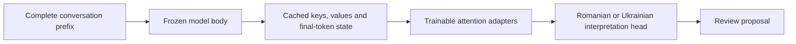

# Training the v9 shared-attention candidate

This experiment adapts a quantized Gemma 4 E4B model for Romanian and Ukrainian
review proposals on a 16 GB Apple Silicon machine. It uses the model's shared
attention keys and values to make repeated training passes affordable. It is a
project-specific training method and evaluation workflow; no claim of inventing
shared attention or establishing real-world child-language accuracy is made.

## What is trained

The pinned model has 42 transformer layers. Its final 18 layers reuse attention
keys and values produced by earlier layers. RoGuard freezes those earlier
layers and the base weights, then trains rank-eight adapters on the final
layers' query and output projections. Separate Romanian and Ukrainian heads
predict six interpretation attributes and a binary review decision. Together,
the adapters and heads contain 2,085,926 trainable parameters.

The cached state includes the full relevant key/value sequence, absolute token
position, masks and per-layer inputs. It is not a summary or a shortened prompt.
Cache identities bind each state to its token sequence and extraction sources.
Large tensor caches and trained weights stay outside Git; manifests and measured
results are tracked.

## Why the cache remains valid during training

Only the final token supplies the classification loss. The earlier layers that
produce shared keys and values remain frozen. Within the adapted layers, the
final token attends to those fixed keys and values; its query, residual state
and output projection are recomputed at every update. Other token positions do
not acquire a new path into the loss through the adapted layers' key/value
projections, because those layers reuse the frozen projections.

This argument depends on this architecture and parameter boundary. It does not
justify changing the embedding, earlier layers, key/value producers or prompt
while reusing the same cache. Numerical equivalence is checked separately from
the mathematical dependency argument.

## Checks and cost

The initial preflight checked full-sequence versus cached execution on training
references, including execution after an actual adapter update. A separate
small-model test checks gradients. The complete extraction then checked 16
training references again; maximum relative feature error was 3.25e-5.

Extraction covered 15,390 inputs: 9,681 training and 5,709 development cases.
It took 2,547 seconds after reference checks, stored 89.59 GB of states and
reached 6.29 GB of peak MLX allocation. This trades disk space and an initial
extraction pass for inexpensive repeated training passes. It does not imply
that a new user's uncached conversation has the same cost as cached training.

The objective combines binary classification, six interpretation losses,
contrasting personal and fictional contexts, and consistency across matched
histories. All training data is synthetic. Development selection examines
binary, independent-policy and coupled-policy outputs at each checkpoint;
scores are not calibrated probabilities of safety.

## Qualification sequence

1. Select weights, output modes and cutoffs using development cases only.
2. Reproduce the selected development scores and full-sequence training
   references, then evaluate separate calibration and exposed-regression cases.
3. Reproduce every prior decision through an installed wheel in a clean
   environment, using the dependencies available to users.
4. Open the reserved synthetic test only after those checks pass.

Each required language/group retains the same minimum 99% concern recall and
maximum 5% benign false-review rate. Abstentions count as errors. The reserved
test is opened once; it cannot become a fresh test again after a failed attempt.
Model proposals grant no permission to contact another person or execute an
external action.

See the [preflight](../research/v9-stabilization/shared-tail-preflight-163/actual/report.json),
[extraction report](../research/v9-stabilization/shared-tail-corpus-164/actual/report.json),
[frozen training protocol](../research/v9-stabilization/shared-tail-fit-165/protocol.json),
and [current qualification results](V9_STABILIZATION.md).
